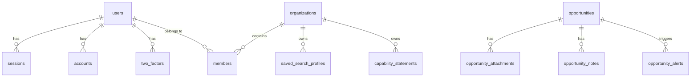

# Sidequest: SAM.gov SDVOSB Capture & Proposal Management Platform

[](https://workers.cloudflare.com/)
[](https://hono.dev/)
[](https://developers.cloudflare.com/d1/)
[](https://orm.drizzle.team/)
[](https://better-auth.com/)
[](tests/)

A multi-user, multi-tenant federal contracting capture engine and opportunity pipeline tailored for Service-Disabled Veteran-Owned Small Businesses (SDVOSB). The system continuously polls SAM.gov Opportunities APIs, flags high-priority RFIs/Sources Sought and Simplified Acquisition Threshold opportunities, stores solicitation files and SOWs in Cloudflare R2, intercepts contracting officer correspondence via Cloudflare Email Routing, enforces strict multi-factor authentication (MFA), and automates proposal response drafting.

- **Live Production URL:** [https://sidequest.curtislamasters.workers.dev](https://sidequest.curtislamasters.workers.dev)
- **GitHub Repository:** [https://github.com/bangsmackpow/sidequest.git](https://github.com/bangsmackpow/sidequest.git)

---

## 🏛 System Architecture & Stack

```
┌────────────────────────────────────────────────────────────────────────┐
│                        Cloudflare Edge Network                         │
├──────────────────┬──────────────────────┬──────────────────────────────┤
│  Scheduled Cron  │  Email Routing       │  HTTP / Web / API            │
│  (*/30 * * * *)  │  (CO Inbound MIME)   │  (Hono + Better Auth + UI)   │
└────────┬─────────┴──────────┬───────────┴──────────────┬───────────────┘
         │                    │                          │
         ▼                    ▼                          ▼
┌──────────────────┐ ┌──────────────────┐ ┌──────────────────────────────┐
│  SAM.gov Search  │ │   Postal-Mime    │ │  SDVOSB Kanban Board         │
│  API Poller      │ │   Email Parser   │ │  Section L RFI Generator     │
└────────┬─────────┘ └────────┬─────────┘ └──────────────┬───────────────┘
         │                    │                          │
         └────────────────────┼──────────────────────────┘
                              │
     ┌────────────────────────┼────────────────────────┐
     ▼                        ▼                        ▼
┌──────────────┐      ┌──────────────┐         ┌──────────────┐
│  D1 SQLite   │      │  R2 Storage  │         │  KV State    │
│  (Metadata)  │      │  (Artifacts) │         │  (Sync Sync) │
└──────────────┘      └──────────────┘         └──────────────┘
```

- **Runtime & Hosting:** Cloudflare Workers & Cloudflare Pages (HONC full-stack pattern).
- **Web Framework:** [Hono v4](https://hono.dev) with typed bindings and context variables.
- **Database:** Cloudflare D1 (SQLite) with [Drizzle ORM](https://orm.drizzle.team) and automated migrations.
- **Object Storage:** Cloudflare R2 (`sidequest-attachments`) for solicitation attachments, SOWs, email archives, and generated Section L capability statements.
- **Caching & KV:** Cloudflare KV (`sidequest-kv`) for polling watermarks and fast session lookups.
- **Authentication:** [Better Auth](https://better-auth.com) with D1 Drizzle adapter, multi-tenant organizations, and role-based access control (`admin`, `manager`, `member`).
- **MFA / TOTP:** Native RFC 6238 Web Crypto TOTP engine with Base32 secrets, standard `otpauth://` QR URI generation, backup codes, and a strict 3-day grace period enforcement.
- **Email Routing:** Cloudflare Email Routing with streaming RFC 822 MIME parser (`postal-mime`) and transactional outbound dispatcher.

---

## 🔐 Authentication, MFA & Access Control

### 1. Initial Administrator Seed Account
The database comes seeded with an initial platform administrator:
- **Email:** `admin@sdvosb-proposals.mil`
- **Initial Password:** `AdminSDVOSB!2026#Secure`
- **Role:** `admin` (Platform Administrator)
- **Organization:** `org_demo_sdvosb` (Valiant Defense Technologies)

> [!IMPORTANT]
> **Change Password on First Login:** Use the user dropdown menu → **"Change Password"** to update your credentials.

### 2. Multi-Factor Authentication (MFA / TOTP)
- Edge-native implementation in [`src/auth/totp.ts`](src/auth/totp.ts) using `crypto.subtle` (HMAC-SHA1, 30-second time steps, ±1 step drift tolerance).
- Standard compatibility with Google Authenticator, Microsoft Authenticator, 1Password, Bitwarden, and Apple Passwords.
- Generates 8 one-time alphanumeric backup recovery codes upon initialization.
- **3-Day Grace Period Enforcement:**
  - **Days 0–3:** The dashboard displays an alert banner showing the countdown of remaining days (`remainingGraceDays`). All capture operations remain accessible.
  - **After Day 3:** If `twoFactorEnabled === false`, all API write/mutation requests (pipeline updates, RFI generation, profile creation) are blocked with `403 MFA_REQUIRED` until MFA setup is verified.

### 3. Password Reset Workflow
- Public self-service password reset request via `POST /api/v1/auth/forgot-password`.
- Cryptographic verification tokens stored in D1's `verifications` table with expiration limits.
- Reset completion via `POST /api/v1/auth/reset-password` updates hashed credentials in `accounts` table using `hashPassword` (`better-auth/crypto`) and purges prior active sessions.

### 4. Administrative User Management Console
Administrators have access to a dedicated Admin Console (via UI or `/api/v1/admin/users/*`):
- **User Roster:** Real-time view of all users, organizational roles, account ages, and MFA compliance states (`Active`, `Grace Period`, or `Expired`).
- **User Creation:** Provision new team members with specific roles and optional temporary passwords (`POST /api/v1/admin/users`).
- **User Editing:** Update user full display names, email addresses, and roles (`PATCH /api/v1/admin/users/:id`). Automatically updates associated credential accounts.
- **Admin Password Reset:** Issue new temporary credentials for team members (`POST /api/v1/admin/users/:id/reset-password`).
- **Admin MFA Reset:** Clear registered authenticator secrets to allow a locked-out user to re-enroll their device (`POST /api/v1/admin/users/:id/reset-mfa`).
- **User Deletion:** Permanently revoke access and purge sessions (`DELETE /api/v1/admin/users/:id`) with safeguards preventing self-deletion.

### 5. Header Sign In & Log Out Workflow
- Prominent **"Log Out"** button located directly in the top navigation bar and inside the user dropdown menu.
- Logging out calls `POST /api/v1/auth/sign-out`, deletes the active session from Cloudflare D1 `sessions`, clears session cookies (`sidequest_session` and `better-auth.session_token`), and resets local storage.
- When signed out, the navbar displays a **"Sign In"** button that opens a modern modal with email, password, and optional TOTP MFA inputs.

---

## 🗄 Database Schema (`src/db/schema.ts`)



1. **Authentication & Multi-Tenancy:**
   - `users`: User identity, email verification, `two_factor_enabled`, `role`, `banned`, `ban_reason`, `ban_expires`.
   - `sessions`: Session tracking with `token`, `expires_at`, `active_organization_id`, `impersonated_by`.
   - `accounts`: Credential and OAuth provider accounts (`provider_id = 'credential'`).
   - `verifications`: Nonce, password reset, and email verification tokens with expiration.
   - `two_factors`: TOTP Base32 secrets, serialized backup recovery codes, and verification status.
   - `organizations`: Multi-tenant organization records.
   - `members`: Tenant membership records mapping `user_id` to `organization_id` with role (`admin`, `manager`, `member`).
2. **`saved_search_profiles`:**
   - Organization-specific NAICS codes (e.g. `["541512", "541519"]`), set-aside codes (`SDVOSBC`, `VOSBC`), notice types (`r` for Sources Sought, `o` for Solicitations), and Simplified Acquisition Threshold ($250,000) limits.
3. **`opportunities`:**
   - Synced SAM.gov notices: `id` (noticeId), `solicitation_number`, `title`, `agency`, `sub_tier`, `office`, `posted_date`, `response_deadline`, `naics_code`, `set_aside_code`, `notice_type`, `ui_link`, `status` (`new`, `reviewing_sow`, `drafting_rfi`, `submitted`, `won`, `lost`, `archived`).
4. **`opportunity_attachments`:**
   - Solicitations, SOWs, and generated capability statements linked to Cloudflare R2 object keys.
5. **`capability_statements`:**
   - Corporate UEI, CAGE code, SBA VetCert SDVOSB certification status, core competencies, and past performance matrices.
6. **`opportunity_notes`:**
   - Capture analyst notes and automatically parsed correspondence from federal Contracting Officers.
7. **`opportunity_alerts`:**
   - High-priority audit trail triggered when incoming opportunities match active search profiles.

---

## ⚡ Core Engine Components

### 1. Worker Ingestion Engine (`src/workers/ingest.ts`)
- Automatically triggered every 30 minutes via Cloudflare Cron (`triggers.crons: ["*/30 * * * *"]`).
- Reads the last sync watermark from KV (`sam_last_sync_timestamp`), defaulting to the past 24 hours.
- Queries `https://api.sam.gov/opportunities/v2/search` with `typeOfSetAside=SDVOSBC` and `ptype=r,o`.
- Paginates transparently when `totalRecords > 100`.
- Stores raw solicitation JSON in R2 at `raw/opportunities/${noticeId}.json`.
- Upserts metadata records into D1 `opportunities` using `onConflictDoUpdate` without disrupting active pipeline stages.
- Cross-references notices against `saved_search_profiles` and creates alert records for high-priority matches.

### 2. Inbound Email Handler (`src/workers/email.ts`)
- Cloudflare native `email` worker handler for `<prefix>@domain.com`.
- Extracts RFC 822 MIME stream and parses headers, text, HTML, and attachments using `postal-mime`.
- Detects federal solicitation numbers and opportunity IDs.
- Archives email text, HTML, and attachments to R2 under `emails/${opportunity_id}/${messageId}/`.
- Logs correspondence into `opportunity_notes` with download links to archived attachments.

### 3. RFI Response & Section L Generator (`src/services/rfi-generator.ts`)
- Generates compliant Sources Sought / RFI capability statements tailored to Section L requirements.
- Automatically injects corporate UEI, CAGE code, SBA VetCert SDVOSB verification status, and **FAR 52.219-27 / 13 CFR § 125.6** subcontracting limitation attestations.
- Generates executive summaries, technical staffing approaches, and past performance matrices.
- Archives generated documents to Cloudflare R2 (`proposals/${oppId}/...`) and transitions opportunity status to `drafting_rfi`.

### 4. Interactive GovTech UI (`src/ui/pages.ts`)
- Modern dark-mode interface styled with Tailwind CSS.
- **Kanban Pipeline Board:** [New Notices] ➔ [Reviewing SOW] ➔ [Drafting RFI] ➔ [Submitted] ➔ [Won / Awarded].
- Instant filtering by NAICS code, set-aside code, Simplified Acquisition Threshold (< $250k), and keyword search.
- One-click SAM.gov polling trigger with real-time sync metrics.
- Modals for Opportunity Details, Contracting Officer correspondence, Search Profiles, and SDVOSB Credentials.

---

## 📡 API Reference

### Public Authentication Endpoints
| Method | Endpoint | Description |
| :--- | :--- | :--- |
| `POST` | `/api/v1/auth/sign-in` | Authenticate with email, password, and optional 6-digit TOTP code |
| `POST` | `/api/v1/auth/sign-out` | Purge session from D1, invalidate session cookies, and log out |
| `POST` | `/api/v1/auth/forgot-password` | Generate verification token and dispatch password reset link |
| `POST` | `/api/v1/auth/reset-password` | Verify reset token and update password hash |

### Authenticated Profile & MFA Endpoints (`/api/v1/auth/*`)
| Method | Endpoint | Description |
| :--- | :--- | :--- |
| `GET` | `/api/v1/auth/me` | Current profile, active role, and MFA compliance / grace status |
| `POST` | `/api/v1/auth/mfa/generate` | Generate TOTP Base32 secret, QR URI, and backup codes |
| `POST` | `/api/v1/auth/mfa/enable` | Verify 6-digit code from authenticator app and activate 2FA |
| `POST` | `/api/v1/auth/mfa/disable` | Verify account password and disable 2FA |
| `POST` | `/api/v1/auth/change-password` | Validate current password and set new password |

### Admin Console Endpoints (`/api/v1/admin/users/*` - Requires `admin` role)
| Method | Endpoint | Description |
| :--- | :--- | :--- |
| `GET` | `/api/v1/admin/users` | List all users with roles, account ages, and MFA compliance states |
| `POST` | `/api/v1/admin/users` | Create new user with assigned role and temporary password |
| `PATCH` | `/api/v1/admin/users/:id` | Update user display name, email address, or role |
| `POST` | `/api/v1/admin/users/:id/reset-password` | Generate new temporary password for user |
| `POST` | `/api/v1/admin/users/:id/reset-mfa` | Reset MFA enrollment for locked-out user |
| `DELETE` | `/api/v1/admin/users/:id` | Permanently delete user account and revoke sessions |

### Capture & Proposal Pipeline Endpoints (`/api/v1/*`)
| Method | Endpoint | Description |
| :--- | :--- | :--- |
| `GET` | `/health` | Health check endpoint |
| `GET` | `/api/v1/stats` | Pipeline metrics and SAM.gov sync watermark |
| `GET` | `/api/v1/opportunities` | List & filter opportunities (`naics`, `set_aside`, `status`, `q`) |
| `GET` | `/api/v1/opportunities/:id` | Opportunity details, attachments, notes, and alerts |
| `PATCH` | `/api/v1/opportunities/:id/status` | Transition opportunity status along the pipeline |
| `POST` | `/api/v1/opportunities/:id/generate-rfi` | Inject SDVOSB credentials and generate Section L RFI |
| `GET` | `/api/v1/opportunities/:id/attachments/:attachmentId/download` | Stream attachment directly from Cloudflare R2 |
| `POST` | `/api/v1/opportunities/:id/notes` | Add manual capture note |
| `GET` | `/api/v1/saved-search-profiles` | List saved search & alert profiles |
| `POST` | `/api/v1/saved-search-profiles` | Create or update search profile |
| `GET` | `/api/v1/capability-statements` | List corporate SDVOSB capability statements |
| `POST` | `/api/v1/capability-statements` | Store corporate capability statement |
| `POST` | `/api/v1/ingest/run` | Manually trigger SAM.gov synchronization |
| `POST` | `/api/v1/email/simulate` | Test inbound email parsing and R2 archiving |
| `POST` | `/api/v1/seed` | Seed demonstration opportunities, profiles, and admin credentials |

---

## 🚀 Setup & Local Development

### 1. Prerequisites
- Node.js (v20+ or v22 LTS recommended)
- `pnpm` (v10+ supported)
- Cloudflare Wrangler CLI

### 2. Installation
```bash
git clone https://github.com/bangsmackpow/sidequest.git
cd sidequest
pnpm install
```

### 3. Local D1 Database Migration
```bash
pnpm run db:migrate
```

### 4. Run Development Server
```bash
pnpm run dev
```
Open [http://localhost:8787](http://localhost:8787) in your browser.

### 5. Run Automated Test Suite
```bash
pnpm test
```
The test suite validates:
- Better Auth password hashing and verification
- TOTP RFC 6238 key generation, OTP auth URIs, and drift verification
- 3-day grace period countdown and expired enforcement logic
- Email validation formats and session cookie parsing
- Postal-Mime RFC 822 email parsing and attachment extraction
- SAM.gov mock poller and date formatting
- Section L RFI response generation and R2 payload formatting

---

## 📦 Cloudflare Deployment & CI/CD

### 1. Provisioned Cloudflare Resources
- **D1 Database:** `sidequest-db` (`ad0afffd-5698-461e-bef4-c4be7e51bc0f`)
- **R2 Storage Bucket:** `sidequest-attachments`
- **KV Namespace:** `sidequest-kv` (`b60aaeb5488f4e80b85e3fd6ef5477e2`)

### 2. Required Cloudflare Secrets
Configure the following secrets in Cloudflare Workers using Wrangler:
```bash
# SAM.gov API Key (from https://sam.gov/content/developer-portal)
npx wrangler secret put SAM_GOV_API_KEY

# Better Auth Secret (random 32+ character string)
npx wrangler secret put BETTER_AUTH_SECRET

# Application Base URL
npx wrangler secret put BETTER_AUTH_URL
```

### 3. Cloudflare CI/CD Build Command
In the Cloudflare Dashboard under **Workers & Pages > sidequest > Settings > Build**, configure:
- **Build command:** `pnpm install && pnpm run db:migrate:remote && npx wrangler deploy`
- **Build environment variables:**
  - `NODE_VERSION`: `22`
  - `PNPM_VERSION`: `10`
- Commits pushed to `main` on GitHub are automatically built, migrated, and deployed.
